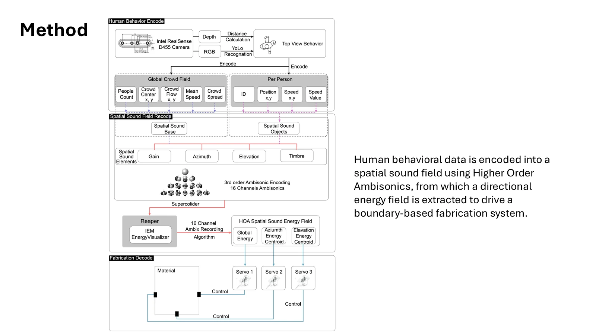
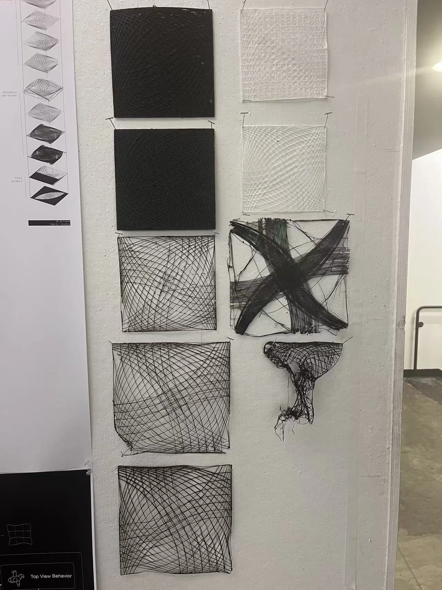
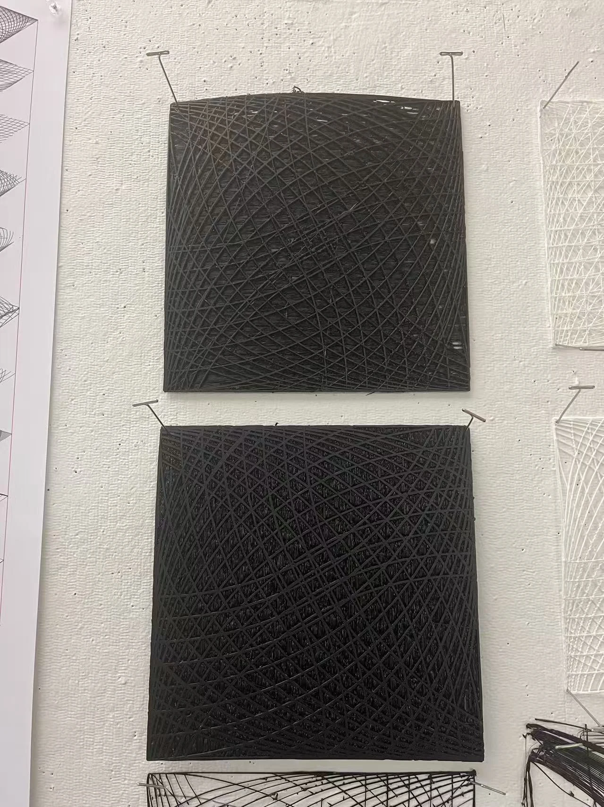
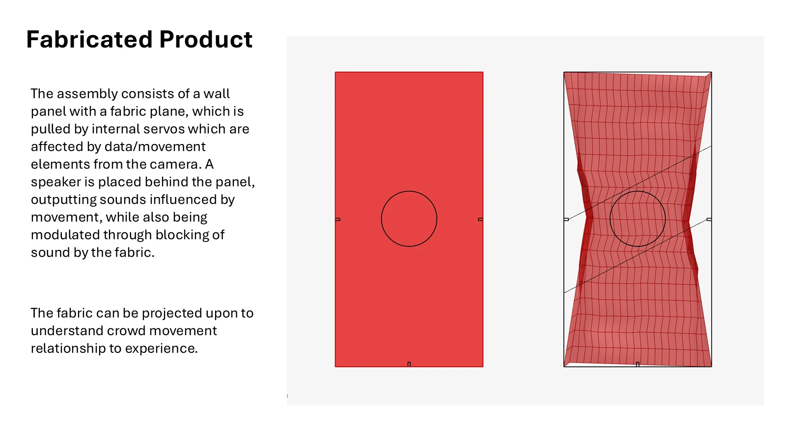
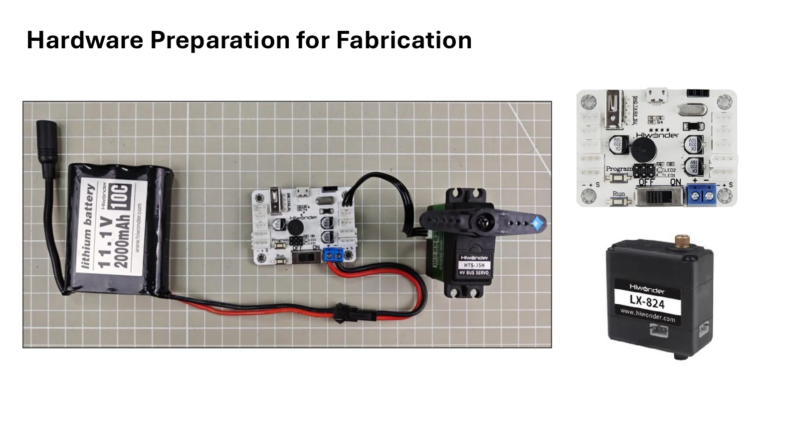

Interactive hardware · Computer vision · Spatial audio · Soft actuation

# Visual and Spatial Sound-Driven Physical Feedback Installation

A responsive installation that senses people in space, relates their behavior to spatial sound energy, and transforms those signals into the physical deformation of a flexible surface.

## Project lead

I lead the project and designed its multimodal interaction workflow: **behavior sensing → spatial-sound encoding → energy analysis → physical response**. A RealSense D455 observes human movement from above; crowd and individual behavior data are encoded into a Higher-Order Ambisonics sound field; directional energy is then translated into commands for six servos that reshape a flexible structure in real time.

The project was developed with **Soumil Majhi** for **ARCH8833 Crafting Acoustic Topologies** at Georgia Tech, instructed by **Misri Patel**. Soumil’s work focuses on Rhino simulation and fabrication studies, while I lead the sensing, sound-field mapping, system integration, and responsive-hardware workflow.

## From two fields to an adaptive space

The proposal begins with two fields that normally remain disconnected in architectural design. Human movement produces a behavioral field defined by occupancy, trajectories, speed, direction, and dispersion. Sound propagation produces another spatial field whose experience changes with listener and source position.

Instead of treating acoustics as a correction applied after a space is designed, the project treats these fields as a **proactive generative system**. Human behavior reshapes the sound field; the sound field is measured as directional energy; and that energy drives an architectural boundary. The result is a space that responds to its occupants rather than remaining a static container.

## Method: behavior to sound to form

<figure class="sfi-ppt-figure"><figcaption>The project workflow links top-view behavior sensing, third-order Ambisonic encoding, a 16-channel AmbiX energy analysis, and servo-driven material deformation.</figcaption></figure>

RGB and depth data from the RealSense D455 are combined with top-view person recognition. The system records two complementary datasets:

| Behavioral layer | Recorded fields | Role in the sound field |
| --- | --- | --- |
| **Global crowd** | count, empty/presence state, center x/y, spread, mean speed, flow x/y | Controls the base layer, overall gain, spatial balance, field rotation, and drift |
| **Per person** | ID, position x/y, velocity x/y, speed | Creates active sound objects with individual timbre, azimuth, elevation, motion, and gain |

The behavior data are rendered as a **third-order Ambisonic field** in SuperCollider. Reaper records the resulting 16-channel AmbiX signal, while the IEM EnergyVisualizer exposes global energy and azimuth/elevation energy centroids. Those measurements become the control layer for the physical boundary.

  
SENSE<b>Human behavior</b><small>RealSense D455 captures crowd and per-person movement data</small>

  <i>→</i>
  
ENCODE<b>HOA sound field</b><small>behavior controls sound objects, gain, azimuth, elevation, and timbre</small>

  <i>→</i>
  
ANALYZE<b>Directional energy</b><small>global energy and azimuth/elevation centroids become control signals</small>

  <i>→</i>
  
RESPOND<b>Flexible surface</b><small>six servos produce visible and tactile deformation</small>

## Behavior and response tests

The prototype was tested with one, two, and three people passing through the sensing area. Each recording combines three synchronized views: overhead person tracking, a spatial sound-energy visualization, and the responsive hardware. Together they show how the same interaction pipeline behaves as the scene becomes more complex.

  <h3>One-person passing</h3>
  <video controls playsinline preload="metadata" poster="/assets/projects/spatial-feedback-installation/one-person-poster.webp">
    <source src="/assets/projects/spatial-feedback-installation/one-person-passing.mp4" type="video/mp4">
  </video>
  
Baseline passage test connecting a tracked body, the sound-energy field, and the deformation of the physical surface.

  <h3>Two-people passing</h3>
  <video controls playsinline preload="metadata" poster="/assets/projects/spatial-feedback-installation/two-people-poster.webp">
    <source src="/assets/projects/spatial-feedback-installation/two-people-passing.mp4" type="video/mp4">
  </video>
  
A two-person trial for observing how the sensing and mapping pipeline responds to overlapping activity.

  <h3>Three-people passing</h3>
  <video controls playsinline preload="metadata" poster="/assets/projects/spatial-feedback-installation/three-people-poster.webp">
    <source src="/assets/projects/spatial-feedback-installation/three-people-passing.mp4" type="video/mp4">
  </video>
  
A higher-density passage trial used to examine the continuity and legibility of the physical response.

## Material exploration

The proposal compared two material directions: a fibrous or jute-like textile with fluid deformation and strong sound bounding, and a 3D-printed fabric whose permeability, attachment points, and stiffness could be designed directly. The current studies use **TPU**, exploring how line density, crossing angle, thickness, color, and boundary tension affect stretch, twist, curvature, and acoustic permeability.

<figure class="sfi-material"><figcaption>Material studies progressing from planar lattice samples to increasingly open and deformable structures.</figcaption></figure>

<figure class="sfi-material"><figcaption>Close-up studies compare crossing patterns and local density within the flexible printed surface.</figcaption></figure>

## Physical actuation

The installation is conceived as a wall panel with a tensioned fabric plane pulled by internally mounted servos. A speaker sits behind the surface: its output responds to movement, while the changing geometry and permeability of the material also modulate how sound passes through the boundary. Projection can add a visual layer that reveals the relationship between crowd movement and the resulting spatial experience.

<figure class="sfi-ppt-figure"><figcaption>Fabricated-product concept: a speaker-backed responsive plane changes shape and acoustic transmission as the servos pull its boundary.</figcaption></figure>

The realized prototype distributes actuation across six servo motors positioned around the flexible structure. Rather than treating the material as a screen, the system uses its tension and elasticity as part of the interaction: a motor command changes local geometry, neighboring regions redistribute that force, and the whole surface develops a continuous spatial response.

<figure class="sfi-ppt-figure"><figcaption>Hardware preparation combines a dedicated servo controller, battery supply, and bus servos before integration into the six-actuator prototype.</figcaption></figure>

This material behavior makes calibration central to the design. Sensor range, mapping curves, servo limits, neutral tension, and response speed must be adjusted together so that movement remains expressive without overstressing the structure.

## Ongoing development

Current work focuses on improving multi-person tracking, refining the relationship between sound-field energy and actuator behavior, and making transitions between deformation states smoother and more repeatable. Future iterations will also study how the installation reads at architectural scale and how physical response can become part of a spatial-audio composition rather than a separate visual layer.

<strong>Project team</strong> Changda Ma · Project Lead — behavior sensing, HOA sound-field mapping, system integration, and responsive hardware Soumil Majhi · Rhino simulation and fabrication studies  <strong>Instructor</strong> <a href="https://www.kent.edu/caed/misri-patel" target="_blank" rel="noopener">Misri Patel</a> <small>ARCH8833 Crafting Acoustic Topologies · Georgia Tech · January 2026–Present</small>

